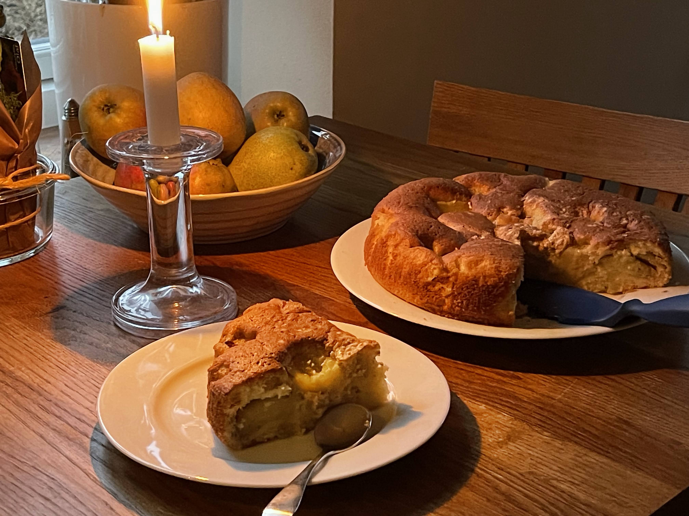
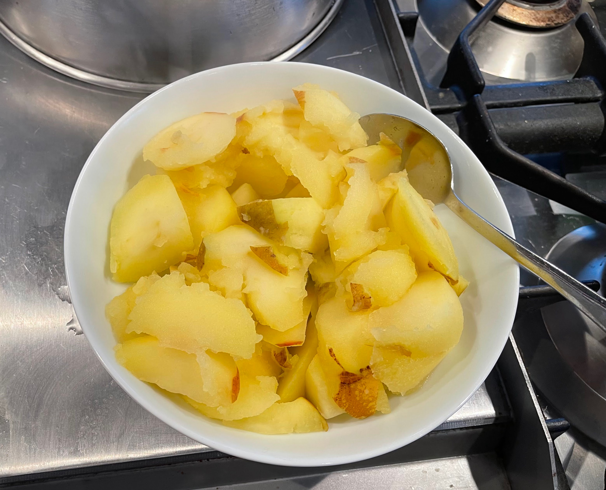
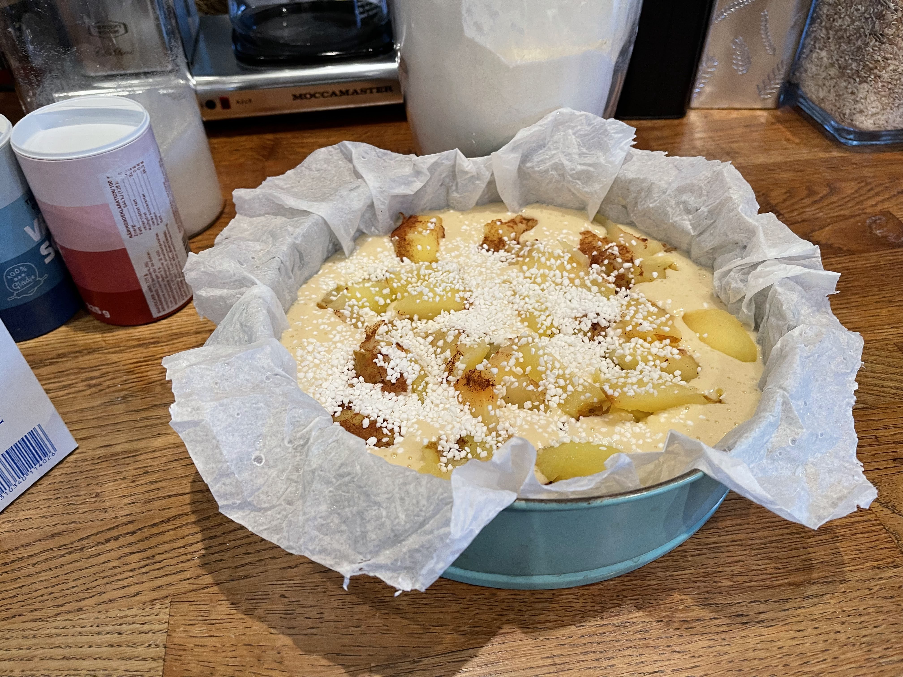

## Ingredienser
- Sätt ugnen på 175 grader
- 3 ägg och 2 dl socker vispas fluffigt
- 3dl vetemjöl
- 1tsk bakpulver
- 1,5tsk vaniljpulver
- smält 150g smör och tillsätt 0,5dl mjöl eller filmjölk
- vispa lätt ihop alla igredienserna

## Gör så här
- **Förberedelse av äpplena**
  - 5st syrliga äpplen skalas och skivas i klyftor, som sjudas några minuter.
  - sila vattnet från äpplena och låt dem kallna
  - stö därefter kanel på äpplena

- **Förberedelse av kakformen**
  - smörj kakformen med smör eller klä den med blött bakplåtspapper
  - häll smeten i formen och toppa den med äpplena
  - strö över med 0,5dl stösocker

