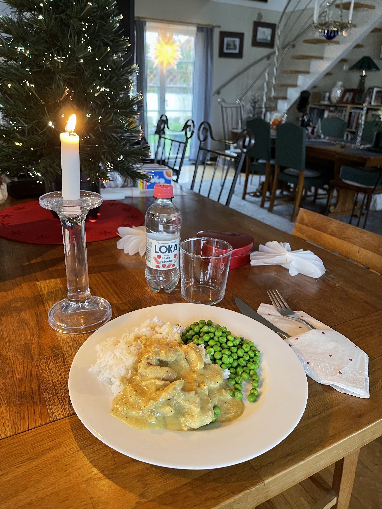

Detta är en lättlagad lunch som smakar gott och med få ingredienser.

4 st.Portioner
## Ingredienser

- 800g kycklingfile
- 2-3 msk smör
- 1 gul lök
- 2-3 msk curry
- 5dl vispgrädde/matlagningsgrädde
- 2st.kycklingbuljong tärningar
- 1/2 dl chilisås
- salt och malen svartpeppar efter smak

## Gör så här

- Dela fileerna i mindre bitar
- Finhacka löken 
- Smält smöret i tjockbottnad kastrull och fräs löken mjuk och glansig på låg värme. 
- Tillsätt curryn och fräs tillsammans med löken en minut. 
- Lägg därefter i kycklingdelarna i kastrullen tillsammans med buljong tärningarna. 
- Steka allt tillsammans några minuter.
- Häll i grädde, chilisås och låt allt koka upp till kycklingen är mjuk och går lätt att dela.
- Smaka av ock salta och peppra efter smak.
- Servera med kokt basmatiris och gröna ärtor.
- Smaklig måltid :) 